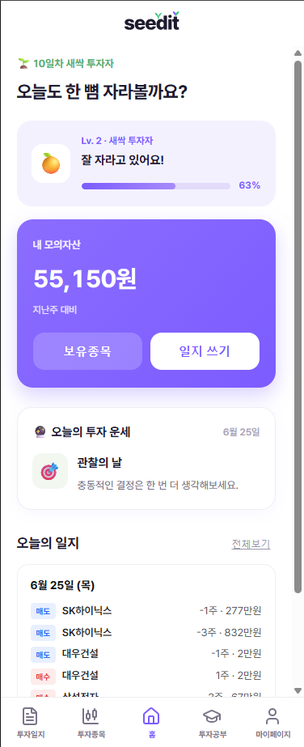
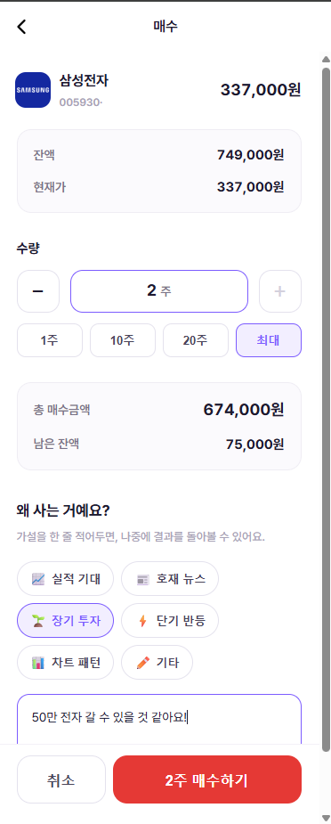
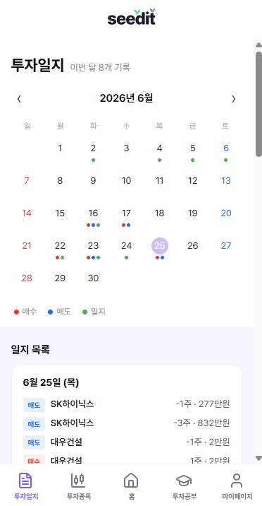
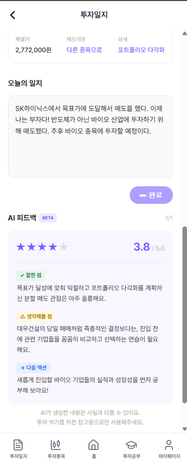

# Seedit Frontend

모의 투자 학습 서비스 **Seedit**의 프론트엔드 레포지토리입니다.

사용자가 가상 잔액으로 종목을 모의 매매하고, 투자할 때 세운 **가설을 기록하고 나중에 복기**하면서 투자 습관을 기르는 것을 목표로 합니다. 투자 일기·레벨·AI 리포트 등 학습을 돕는 기능을 함께 제공하는 [seedit-backend](../seedit-backend) API 서버와 연동됩니다.

## 주요 기능

- 온보딩 · 회원가입 · 로그인 (JWT 기반 인증)
- 홈: 모의자산/포트폴리오 요약, 거래 내역, 단타 경고 알림, AI 포트폴리오 리포트
- 투자종목: 종목 목록 검색 및 관심종목 필터, 종목 상세(차트), 모의 매수/매도와 투자 가설 작성
- 투자일지: 캘린더 기반 일기 조회/작성, AI 피드백
- 투자공부: 금융 지식 콘텐츠, 즐겨찾기, AI 데일리 경제 리포트
- 마이페이지: 프로필/활동 내역, 내 정보 수정, 비밀번호 변경

## 기술 스택

| 구분 | 사용 기술 |
| --- | --- |
| Framework | Vue 3 |
| Build Tool | Vite |
| Routing | Vue Router |
| State Management | Pinia |
| HTTP Client | Axios |
| Icons | lucide-vue-next |
| Lint / Format | ESLint, oxlint, Prettier |
| Test | Vitest, @vue/test-utils |

## 빠른 시작

```bash
# 1) 클론
git clone <frontend-repo-url>
cd seedit-frontend

# 2) 깃 훅 활성화 (클론마다 1회)
git config core.hooksPath .githooks

# 3) 환경 변수 설정
cp .env.example .env
# .env 에서 백엔드 API 주소 확인/수정
# VITE_API_BASE_URL=http://localhost:8080/api

# 4) 의존성 설치
npm install

# 5) 개발 서버 실행
npm run dev
```

Node.js 버전은 `^20.19.0` 또는 `>=22.12.0` 이 필요합니다.

## 사용 가능한 스크립트

```bash
npm run dev          # 개발 서버 실행 (HMR)
npm run build         # 프로덕션 빌드
npm run preview       # 빌드 결과 미리보기
npm run test:unit     # Vitest 단위 테스트 실행
npm run lint          # oxlint + eslint 검사 및 자동 수정
npm run format         # Prettier 포맷팅 (src/)
```

## 프로젝트 구조

```
src
├── main.js                 # 앱 엔트리 포인트 (Pinia, Router 등록)
├── App.vue                 # 루트 컴포넌트
│
├── api                     # axios 기반 API 모듈 (도메인별)
│   ├── client.js           # axios 인스턴스, 인터셉터
│   ├── auth.js / user.js
│   ├── stocks.js / watchlist.js / trades.js
│   ├── diary.js / study.js / report.js / news.js
│
├── stores                  # Pinia 스토어
│   ├── auth.js              # 로그인 상태, 토큰
│   ├── stocks.js / diary.js / study.js
│   └── header.js            # 라우트별 상단 헤더 상태
│
├── router
│   └── index.js             # 라우트 정의 (인증 플로우 / 메인 플로우), 네비게이션 가드
│
├── layouts
│   ├── AuthLayout.vue        # 탭바 없는 인증 플로우 레이아웃
│   └── MainLayout.vue        # 탭바 있는 메인 플로우 레이아웃 (로그인 필요)
│
├── views
│   ├── home/                 # 홈, 포트폴리오, 거래 내역, 알림, AI 리포트
│   ├── market/                # 종목 목록/상세, 모의 매수/매도
│   ├── diary/                  # 투자일지 목록/상세
│   ├── study/                  # 투자공부 콘텐츠, 데일리 리포트
│   ├── profile/                 # 마이페이지, 설정, 비밀번호 변경
│   └── LoginView.vue / SignupView.vue / OnboardingView.vue / SplashView.vue
│
├── components               # 공통 컴포넌트 (아이콘 등 포함)
├── constants                # 상수 정의 (예: 투자 가설 태그)
└── assets                   # 정적 리소스
```

## 라우팅 개요

- `/splash`, `/onboarding`, `/login`, `/signup` — 인증 플로우 (`AuthLayout`, 탭바 없음)
- `/home`, `/market`, `/diary`, `/study`, `/mypage` — 메인 플로우 (`MainLayout`, 탭바 있음, `requiresAuth: true`)
- 로그인 여부는 `localStorage`의 `accessToken` 존재 여부로 판단하며, 인증이 필요한 경로 접근 시 `login`으로 리다이렉트됩니다.

## 환경 변수

| 변수 | 설명 | 예시 |
| --- | --- | --- |
| `VITE_API_BASE_URL` | 백엔드 API 베이스 URL | `http://localhost:8080/api` |

## 화면 설계

> 전체 화면(31개)의 캡처와 설명은 **[화면 설계 문서](docs/screens.md)** 에서 볼 수 있습니다.  
> [인증](docs/screens.md#인증-플로우) · [홈](docs/screens.md#홈-탭) · [투자종목](docs/screens.md#투자종목-탭) · [투자일지](docs/screens.md#투자일지-탭) · [투자공부](docs/screens.md#투자공부-탭) · [마이페이지](docs/screens.md#마이페이지-탭)

| 홈 대시보드 | 모의 매수 · 투자 가설 | 투자일지 캘린더 | AI 일지 피드백 |
| :---: | :---: | :---: | :---: |
| <a href="docs/screens.md#홈-탭"></a> | <a href="docs/screens.md#투자종목-탭"></a> | <a href="docs/screens.md#투자일지-탭"></a> | <a href="docs/screens.md#투자일지-탭"></a> |
| 레벨 · 모의자산 · 오늘의 일지 | 매수하면서 투자 가설 기록 | 날짜별 거래 · 일지 기록 확인 | 거래 · 일지 기반 AI 피드백 |
